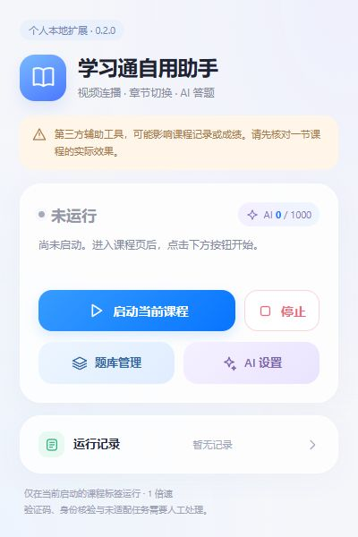

# HuiGod刷课 · 学习通自用助手

实验性的 Edge / Chrome Manifest V3 浏览器扩展。提供课程视频连播、任务切换、本地题库匹配、可选的 AI 文字/图片作答与章节测验提交。



## 当前版本

v0.2.0：浅色圆角界面，题库与 AI 设置独立；默认每次最多 1000 次 AI 调用，可设置 1–10000 次；临时播放中断有限重试；同页与可访问父层的确认提交弹窗处理。

## 安装

解压 `HuiGod刷课.zip`，在 Edge 的 `edge://extensions` 或 Chrome 的 `chrome://extensions` 中加载 **extension 目录**。该目录应直接包含 `manifest.json`。

刷新课程页，从工具栏“学习通自用助手”启动。题库和 AI 均由使用者自行配置，没有内置的课程付费题库或免费 AI 额度。详细步骤见 [使用说明](使用说明.md) 和 [离线教程](使用教程.html)。

## 开发与检查

需要 Node.js 24 或兼容版本。

```sh
npm ci --ignore-scripts
npm test
npm run check
```

`extension/` 为可直接加载的本地源码，`tests/` 包含 Node / jsdom / 扩展 API 模拟测试。`python tests/preview_server.py` 可启动仅绑定本机的界面预览，使用内存模拟数据，不操作课程、不调用 AI。

## 实现要点

- 页面内容脚本处理已适配的 DOM 控件，后台串行管理运行状态和异步请求。
- 运行限于手动启动的课程标签；停止、导航或题目更新后丢弃不适用的延迟答案。
- 多选幂等、乱序选项按内容映射；未匹配或不完整答案暂停，不猜选项。
- 提交前验证填写结果，确认按钮至多点击一次，识别到结果后才进入下一任务。
- API 密钥仅在受限扩展存储内使用，不回显、不提供给课程内容脚本、不包含在交付包中。

## 验证边界

本地测试及预览不等同于真实课程验收。历史的小样本文字/色块图 API 测试成功，不证明真实题目答案正确或字体渲染完整。不同学校页面、跨域弹窗、文档任务和播放策略可能不兼容。

不提供验证码、人脸识别、正式考试处理或免封禁保证，不伪造学习完成记录。使用第三方自动化可能违反平台或学校要求，学习记录及成绩以实际平台和学校认定为准。

## 发布说明

项目处于测试阶段。公开发布前由作者确定自有代码许可证。第三方 html2canvas 及其打包依赖的许可证见 `extension/vendor/THIRD_PARTY_NOTICES.txt`，应随分发保留。请勿提交真实 API Key、浏览器配置文件、Cookie 或个人课程记录。
